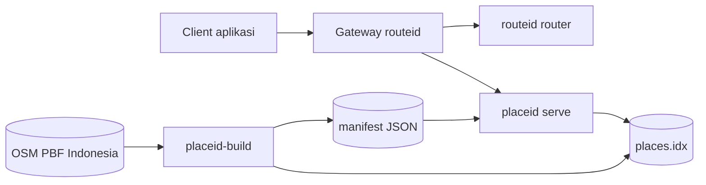
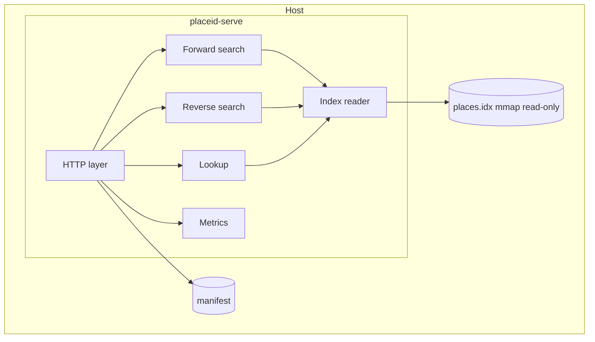
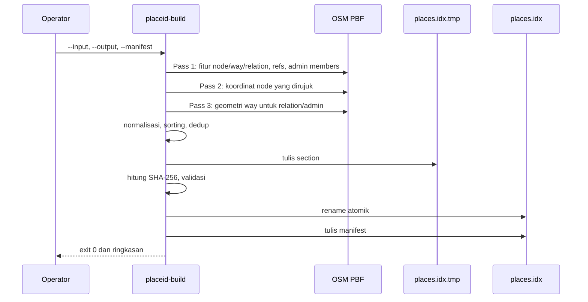
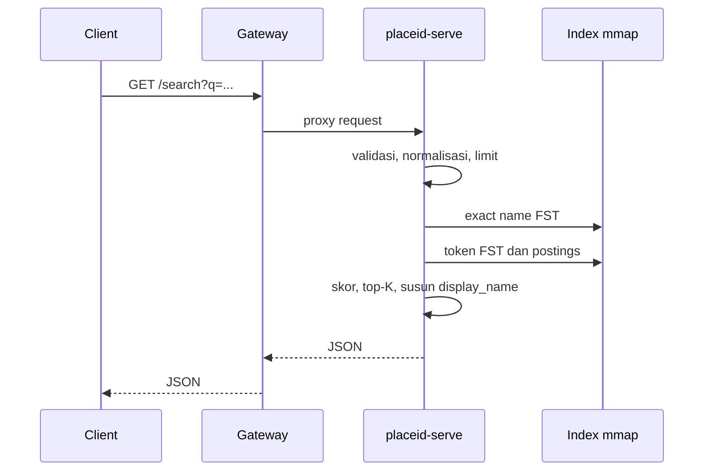
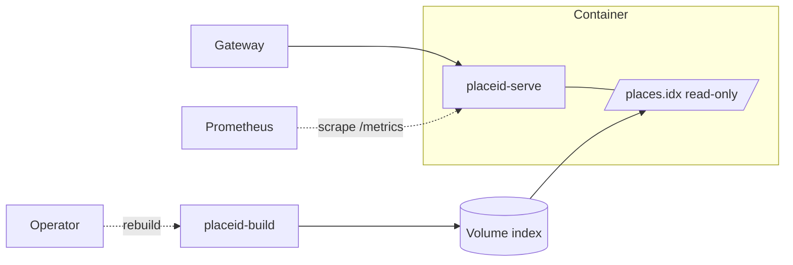

# Arsitektur placeid

Dokumen ini menunjukkan bentuk sistem dan batas komponen. Requirement ada di
[SRS](SRS.md); keputusan teknis dan ranking ada di [TRD](TRD.md).

## 1. Konteks

`placeid` adalah layanan internal di belakang gateway routeid. Klien tidak
perlu tahu apakah pencarian dilayani router atau geocoder.

Batas tanggung jawab:

| Komponen | Tanggung jawab |
|---|---|
| Gateway | TLS, auth, rate limit, routing |
| `placeid-serve` | Validasi request, pencarian, penyusunan respons |
| `places.idx` | Data fitur, nama, postings, grid, admin |
| `placeid-build` | Seleksi PBF, geometri, normalisasi, penulisan index |
| Manifest | Provenance, versi, checksum, jumlah fitur |

## 2. Container

Tidak ada komponen yang menulis ke index saat serve. Tidak ada cache query
global di v1. Setiap request membaca record dari mmap dan menyusun hasil di
stack atau buffer request.

## 3. Alur build

Jika pass mana pun gagal, file `.tmp` dihapus dan index lama tidak berubah.
Manifest ditulis setelah index selesai agar tidak ada manifest yang menunjuk
index setengah jadi.

## 4. Alur query

Reverse memakai jalur yang sama, tetapi masuk lewat grid dan menghitung jarak.
Lookup masuk lewat binary search `place_id` atau parse `osm_ids`.

## 5. Deployment

Satu container melayani satu index. Untuk ketersediaan lebih tinggi, jalankan
dua replika dengan index yang sama di belakang gateway. v1 tidak menyediakan
koordinasi antar replika; promosi index dilakukan dengan mengganti volume atau
restart bergilir.

## 6. Invariant

1. Server hanya membaca index. Tidak ada jalur tulis ke index saat runtime.
2. Index bersifat immutable selama satu proses hidup. Index baru berarti
   proses baru atau restart.
3. `place_id` diturunkan dari `(osm_type, osm_id)`, bukan nomor urut build.
4. Build deterministik untuk PBF dan versi builder yang sama.
5. Tidak ada database, PBF, atau jaringan keluar di jalur serve.
6. `display_name` disusun dari nama fitur dan rantai admin, bukan string
   panjang yang disimpan per fitur.
7. Polygon admin opsional. Tanpa polygon, `address` kosong, bukan dikarang.
8. Semua offset index divalidasi sebelum dipakai.

## 7. Batas repo

| Di dalam repo | Di luar repo |
|---|---|
| Kode builder dan server | Gateway routeid |
| Format index dan manifest | PBF mentah |
| Dokumentasi API | Data index hasil build |
| Fixture PBF kecil | Deployment produksi |
| Test dan benchmark harness | Dashboard monitoring |

Repo tidak menyimpan `*.pbf`, `places.idx`, atau `target/`. Artefak index
dipromosikan lewat volume atau object storage, bukan lewat git.
