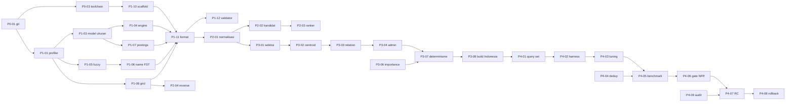

# Backlog placeid

| Field | Value |
|---|---|
| Status | Draft |
| Tanggal | 2026-11-13 |
| Dokumen terkait | [ROADMAP](ROADMAP.md), [SRS](SRS.md), [TRD](TRD.md), [research/LIGHTWEIGHT-METHODS](research/LIGHTWEIGHT-METHODS.md) |

Backlog ini memecah [ROADMAP](ROADMAP.md) menjadi pekerjaan yang bisa
diverifikasi. Tidak ada tanggal. Urutan ditentukan oleh risiko: hal yang bisa
membatalkan format index atau pilihan engine dikerjakan sebelum format
dibekukan.

## 1. Cara memakai backlog

- ID task berpola `P<fase>-<nomor>`. ID tidak berubah saat status berubah.
- Dokumen ini tidak menyimpan status per task. Saat dilacak di issue tracker,
  status memakai `todo`, `doing`, `blocked`, `done`, dengan maksimum satu
  task `doing` per orang.
- Ukuran relatif, bukan hari:
  - `S`: satu file atau satu fungsi, satu test.
  - `M`: satu modul, beberapa test, kontrak sudah jelas.
  - `L`: lintas modul atau butuh keputusan. `L` wajib dipecah sebelum
    dikerjakan.
- Acceptance harus bisa dijalankan. "Sudah diimplementasikan" bukan
  acceptance.
- Task selesai jika acceptance lulus, test ada, dan dokumen terkait
  diperbarui. Untuk perubahan kontrak, ADR wajib.
- Task yang mengubah `FR-xxx` atau `NFR-xxx` harus memperbarui matriks
  traceability di [SRS](SRS.md).
- Task `blocked` harus menyebut blocker dan task yang membuka blocker.

## 2. Prinsip urutan

1. Ukur sebelum membekukan format. Tiga keputusan format yang paling mahal
   adalah layout grid, encoding postings, dan recall name FST.
2. Pilih engine dengan data, bukan preferensi. ADR 0002 mengikat keputusan
   custom index pada gate ukuran, RSS, latency, dan fuzz.
3. Jangan membangun fitur ranking sebelum ada query set berlabel. Tanpa
   label, tuning hanya menebak.
4. Build Indonesia adalah uji integrasi terbesar. Jangan menunggu Fase 4
   untuk menjalankannya.
5. Setiap klaim performa harus punya perintah yang bisa diulang dan hasil di
   [BENCHMARKS](BENCHMARKS.md).

## 3. Ringkasan fase

| Fase | Fokus | Jumlah task | Gate keluar |
|---|---|---:|---|
| P0 | Fondasi repo dan dokumen | 5 | Repo bisa di-clone, CI dasar lulus, dokumen konsisten |
| P1 | Spike risiko dan format index | 14 | Format v1 beku, engine dan fuzzy dipilih dengan data |
| P2 | Query minimum | 12 | Semua endpoint melayani fixture |
| P3 | Build Indonesia | 9 | Index Indonesia memenuhi NFR-003 dan NFR-006 |
| P4 | Kualitas dan release candidate | 9 | NFR-001 sampai NFR-013 lulus atau deviasi dicatat |
| P5 | Operasi berulang | 5 | Rebuild kedua dan rollback lulus |

## 4. Fase 0: Fondasi

| ID | Pekerjaan | Acceptance | Dep | Ukuran | Ref |
|---|---|---|---|---|---|
| P0-01 | Inisialisasi git, remote, dan commit baseline dokumen, verifikasi `.gitignore` menolak PBF, index, dan hasil benchmark | `git status` bersih setelah commit; `origin` menunjuk `arifsans/placeid`; commit baseline terdorong; `git check-ignore` menolak `*.osm.pbf`, `*.idx`, `*.idx.json`, `bench-results/` | - | S | CONTRIBUTING |
| P0-02 | Audit konsistensi dokumen: requirement `MUST` yang bertentangan, tautan relatif mati, label target vs hasil, em dash | Skrip pemeriksa tautan lulus; daftar konflik requirement kosong; tidak ada em dash di dokumen | P0-01 | M | ROADMAP Fase 0 |
| P0-03 | Pin toolchain: `rust-toolchain.toml`, komponen `rustfmt` dan `clippy`, catat versi di README | `rustup show` memakai versi yang dipin; `cargo fmt --version` dan `cargo clippy --version` tersedia; versi Rust tercatat | P0-01 | S | TRD §11 |
| P0-04 | CI dasar: fmt, clippy, test, `cargo audit`, pemeriksa tautan, larangan file data besar | CI lulus pada commit dokumen; job cargo ditandai skipped sampai crate ada di P1-10; job gagal jika PBF atau index masuk repo | P0-03 | M | CONTRIBUTING |
| P0-05 | Template ADR dan aturan review keputusan | Template berisi konteks, keputusan, konsekuensi, alternatif; `docs/README.md` merujuk template | P0-02 | S | docs/README |

Exit: repo punya baseline yang bisa di-clone, CI dasar lulus, dan tidak ada
kontradiksi requirement yang diketahui.

## 5. Fase 1: Spike risiko dan format index

Spike menghasilkan angka dan keputusan, bukan kode produksi. Kode spike boleh
dibuang, hasilnya masuk ke dokumen riset atau ADR.

| ID | Pekerjaan | Acceptance | Dep | Ukuran | Ref |
|---|---|---|---|---|---|
| P1-01 | Profiler korpus: hitung fitur bernama per kategori, nama unik, token unik, occurrences, duplikasi nama, occupancy grid, bbox | Laporan JSON berisi angka terukur; selisih jumlah fitur bernama terhadap README ≤ 1%; tidak ada data OSM yang disalin ke repo | P0-01 | M | FR-002, FR-005 |
| P1-02 | Spike throughput build: dua pass `osmpbf` pada PBF Indonesia, ukur MB/s, waktu per pass, peak RSS | Waktu dua pass dan peak RSS tercatat; ekstrapolasi tiga pass dibandingkan dengan NFR-006 | P0-03 | M | NFR-006 |
| P1-03 | Model ukuran index: places, strings, variants, postings, FST, grid dense vs sparse, admin polygon | Tabel ukuran per section dengan rumus dan angka korpus; skenario terburuk ≤ 600 MB dengan margin ≥ 20% | P1-01 | M | NFR-003, INDEX-FORMAT |
| P1-04 | Spike engine: custom FST, SQLite FTS5, Tantivy pada korpus nama yang sama | Tabel build time, ukuran file, idle RSS, p95 search, top-1 pada 50 query; keputusan engine dengan ADR | P1-02, P1-03 | L | ADR 0002, NFR-001, NFR-004 |
| P1-05 | Spike fuzzy: prefix-only, Levenshtein automaton `fst`, SymSpell deletion index | Recall pada 45 query typo/alias dan p95 per strategi; keputusan fuzzy dengan ADR bila menambah section format | P1-01 | L | FR-005, FR-006, NFR-001 |
| P1-06 | Keputusan recall name FST untuk nama duplikat | Skenario `Indomaret` mengembalikan lebih dari satu kandidat; keputusan postings range atau token-only tercatat, INDEX-FORMAT diperbarui | P1-05 | M | FR-004, INDEX-FORMAT §10 |
| P1-07 | Keputusan encoding postings: `u32` tetap atau delta varint | Ukuran dan latency kedua encoding diukur; format v1 diperbarui; decoder punya test batas | P1-03 | M | INDEX-FORMAT §9 |
| P1-08 | Keputusan grid: dense vs sparse, ukuran sel 0,01, 0,02, atau 0,05 derajat, ring search | Occupancy dan biaya byte diukur; radius 1 km dan 10 km punya jumlah sel dan kandidat terukur; INDEX-FORMAT diperbarui | P1-01, P1-03 | M | FR-007, INDEX-FORMAT §11 |
| P1-09 | Keputusan sumber `importance`: tag OSM saja atau tabel Wikipedia/Wikidata | Top-1 pada 100 query dengan dan tanpa tabel eksternal; biaya ukuran dan lisensi dicatat; ADR jika memakai data eksternal | P1-01 | M | FR-006, NFR-013 |
| P1-10 | Scaffold crate sesuai TRD: `lib.rs`, modul build/index/search/api, dua binary, feature gate | `cargo build --release` menghasilkan `placeid-build` dan `placeid-serve`; `lib.rs` tidak membuka HTTP atau environment | P0-03 | M | TRD §4 |
| P1-11 | Writer dan reader format v1: header, section table, places, strings, dictionary, postings, trailer | Fixture kecil ditulis, dibaca ulang, dan nilainya sama; section align 8 byte; dua build fixture identik | P1-04, P1-05, P1-06, P1-07, P1-08, P1-10 | L | FR-001, FR-013, FR-014 |
| P1-12 | Validator index dan suite fixture rusak | 14 aturan validasi INDEX-FORMAT §16 punya test negatif; fuzz parser tidak menemukan panic | P1-11 | M | NFR-008 |
| P1-13 | `place_id` encode/decode dan batas 53-bit | Test untuk node, way, relation, `osm_id = 2^51 - 1`, overflow, dan dua build stabil | P1-10 | S | FR-003, ADR 0003 |
| P1-14 | Manifest dan penulisan atomik | Build gagal tidak merusak index lama; manifest memuat semua field FR-013; rename atomik diuji | P1-11 | M | FR-001, FR-013 |

Exit: format v1 beku, engine dan strategi fuzzy dipilih dengan angka, dan
semua keputusan format punya ADR atau catatan di INDEX-FORMAT.

## 6. Fase 2: Query minimum

| ID | Pekerjaan | Acceptance | Dep | Ukuran | Ref |
|---|---|---|---|---|---|
| P2-01 | Normalisasi dan tokenisasi bersama builder dan server | Tabel test mencakup NFKC, diakritik, tanda baca, `Jl.`, `Kec.`, `Kab.`, `Kel.`, `Kp.`, `No.`, token satu karakter, dan spasi ganda | P1-11 | M | FR-005 |
| P2-02 | Kandidat forward: exact, prefix, irisan postings, batas kandidat, top-K heap | Query exact dan prefix mengembalikan kandidat; query token umum tidak melebihi batas kandidat; urutan deterministik | P2-01, P1-11 | L | FR-004, FR-006 |
| P2-03 | Ranker v1: exact, prefix, cakupan token berbobot IDF, `importance`, proximity, tie-break | Bobot bisa diubah tanpa rebuild; exact mengalahkan prefix; semua token mengalahkan sebagian; input sama menghasilkan urutan sama | P2-02, P1-09 | M | FR-006 |
| P2-04 | Reverse: ring search, haversine, prioritas jenis, 404 | Radius 1 km dan 10 km mengembalikan fitur terdekat; titik tanpa fitur mengembalikan 404 `not_found`; batas radius divalidasi; titik pada jalan dengan bbox >1 km diuji dan hasilnya dicatat | P1-08, P1-11 | L | FR-007 |
| P2-05 | Lookup `osm_ids` dan `place_ids` | Urutan permintaan dipertahankan; ID hilang dihilangkan; lebih dari 50 ID atau kedua parameter sekaligus menghasilkan 400 | P1-11 | M | FR-008 |
| P2-06 | Kerangka HTTP `axum`: routing, ekstraksi parameter, validasi, error JSON | Semua kondisi FR-012 punya status dan body `{error, reason}`; 405 menyertakan `Allow` | P1-10 | M | FR-010, FR-012 |
| P2-07 | Perakitan respons jsonv2 | Field minimum ada; `lat`/`lon` string; `place_id`/`osm_id` angka; `licence` menyebut ODbL; `addressdetails=1` menambah `address` | P2-06, P1-11 | M | FR-010, FR-011, ADR 0004 |
| P2-08 | `/healthz`, `/version`, `/metrics` | `/healthz` gagal tanpa index; `/version` memuat checksum manifest; `/metrics` bisa diparse Prometheus | P2-06 | M | FR-011, NFR-009 |
| P2-09 | Logging terstruktur dan privasi default | Setiap request punya ID; log default tidak memuat `q`, `lat`, `lon`, atau ID; debug eksplisit diberi penanda | P2-06 | S | FR-016, NFR-010 |
| P2-10 | Siklus hidup server: mmap read-only, validasi header, tanpa tulis | Index read-only bisa dipakai; tidak ada file baru di direktori index; checksum opsional diuji | P1-12 | M | FR-013, FR-015 |
| P2-11 | Fixture PBF dan test integrasi semua endpoint | Build fixture, start server, panggil search, reverse, lookup, health, version, metrics; tidak ada panic pada input invalid | P2-04, P2-05, P2-07, P2-08, P2-10 | M | SRS §9 |
| P2-12 | Image container dan smoke test | Image non-root, root filesystem read-only, index read-only; smoke test lulus di amd64 dan arm64 (cross-build atau qemu) | P2-11 | M | NFR-007, NFR-012 |

Exit: semua endpoint di API.md melayani fixture, tidak ada panic pada input
invalid, dan image container bisa dijalankan.

## 7. Fase 3: Build Indonesia

| ID | Pekerjaan | Acceptance | Dep | Ukuran | Ref |
|---|---|---|---|---|---|
| P3-01 | Seleksi fitur dan pencatatan kategori | Hanya fitur bernama yang lolos; `addr:housenumber` tanpa nama tidak masuk; manifest memuat jumlah per kategori | P1-11, P2-01 | M | FR-002 |
| P3-02 | Resolusi koordinat way dan node referensi | Centroid way benar untuk fixture; node hilang dihitung; fitur tanpa koordinat dilewati dan dicatat | P3-01 | M | TRD §5.2 |
| P3-03 | Geometri relation dan admin | Ring `outer`/`inner` tersusun; polygon tidak valid dilewati dan dicatat; centroid relation POI dihitung | P3-02 | L | TRD §5.3 |
| P3-04 | Hierarki admin level 4 sampai 7 | `admin_id` menunjuk parent terdalam; polygon terkecil menang saat overlap; tidak ada siklus; `address` kosong jika tidak ada parent | P3-03 | L | FR-009 |
| P3-05 | Varian nama, alias, dan `accept-language` | `name:id`, `name:en`, `alt_name`, `old_name`, `official_name`, `short_name`, `brand` terindeks; nama asli di output; fallback ke `name` | P3-01 | M | FR-005, FR-009 |
| P3-06 | Perhitungan `importance` | Nilai finite 0 sampai 1; admin dan `place` di atas `highway`, `highway` di atas POI, POI di atas bangunan; bonus `population`, `capital`, `wikidata`, `brand` | P3-01 | M | FR-006 |
| P3-07 | Build deterministik | Dua build menghasilkan SHA-256 body identik; tidak ada iterasi hash map; manifest hanya berbeda pada `built_at` | P3-01, P3-04, P3-05, P3-06 | M | FR-014 |
| P3-08 | Build Indonesia penuh | Build selesai ≤ 15 menit pada mesin referensi; index ≤ 600 MB; jumlah fitur, dilewati, polygon invalid, dan warning tercatat di manifest | P3-07, P1-12 | L | NFR-003, NFR-006 |
| P3-09 | Smoke test index Indonesia | Server start ≤ 1 detik sampai `/healthz`; 20 query nama, jalan, wilayah, dan POI mengembalikan minimal satu hasil di dalam bbox Indonesia; 10 reverse mengembalikan fitur atau 404 yang valid | P3-08 | M | NFR-005 |

Exit: index Indonesia bisa dibangun ulang, dibaca server, dan angka ukuran
serta waktu build masuk ke BENCHMARKS.

## 8. Fase 4: Kualitas dan release candidate

| ID | Pekerjaan | Acceptance | Dep | Ukuran | Ref |
|---|---|---|---|---|---|
| P4-01 | Query set 300 berlabel | Stratifikasi sesuai BENCHMARKS §4; setiap query punya `osm_type` dan `osm_id` atau daftar fitur yang diterima; disimpan sebagai data uji, bukan data OSM mentah | P3-09 | L | NFR-013 |
| P4-02 | Harness evaluasi relevansi | Menghitung top-1, top-5, empty rate, dan reverse distance error per kategori; split tune dan holdout dicatat | P4-01 | M | NFR-013 |
| P4-03 | Tuning ranking dengan holdout | Top-1 ≥ 80% dan top-5 ≥ 95%; perubahan bobot dicatat; hasil holdout tidak dipakai untuk tuning | P4-02 | L | FR-006, NFR-013 |
| P4-04 | Dedup dan keragaman hasil | Tidak ada `place_id` duplikat di satu respons; query `Indomaret` dengan `limit=5` mengembalikan 5 `place_id` unik; nama duplikat mengembalikan beberapa kandidat | P4-02 | M | FR-004 |
| P4-05 | Benchmark lengkap sesuai BENCHMARKS | p50, p95, p99, throughput, error rate, RSS, startup, build, ukuran index tercatat dengan commit dan mesin | P3-08, P4-03, P4-04 | L | NFR-001 sampai NFR-006 |
| P4-06 | Review gate NFR | Semua NFR lulus atau punya deviasi tertulis dan rencana perbaikan; tidak ada `MUST` yang ditunda tanpa ADR | P4-05 | M | SRS §5 |
| P4-07 | Release candidate | Manifest, checksum, image digest, dan catatan rilis tersedia; audit dependency dan lisensi selesai; index dan manifest dipromosikan sebagai satu unit | P4-06, P4-09 | M | FR-013 |
| P4-08 | Uji promote dan rollback | Promote index baru tanpa restart gagal; rollback ke index sebelumnya berhasil; server menolak checksum salah | P4-07 | M | OPERATIONS, FR-013 |
| P4-09 | Audit dependency, lisensi, dan atribusi | `cargo audit` bersih atau risiko dicatat; lisensi dependency kompatibel; respons API memuat ODbL | P1-10, P2-07 | S | NFR-011 |

Exit: NFR-001 sampai NFR-013 lulus atau deviasi tercatat, dan rollback sudah
diuji.

## 9. Fase 5: Operasi berulang

| ID | Pekerjaan | Acceptance | Dep | Ukuran | Ref |
|---|---|---|---|---|---|
| P5-01 | Runbook rebuild bulanan | Perintah rebuild, verifikasi manifest, dan promosi bisa dijalankan dari nol oleh orang lain | P4-08 | M | OPERATIONS |
| P5-02 | Otomasi promote dan rollback | Symlink atau path aktif berubah atomik; checksum diverifikasi sebelum promote; rollback satu perintah | P5-01 | M | OPERATIONS |
| P5-03 | Alert operasional | Alert untuk `/healthz` gagal, index lebih tua dari 45 hari, p95 di atas target, dan error rate naik | P5-01 | M | OPERATIONS |
| P5-04 | Dashboard dan retensi log | Dashboard memuat request, latency, error, ukuran index, kandidat; log tidak menyimpan query default | P5-03 | M | FR-016, NFR-009 |
| P5-05 | Rebuild kedua dan catatan rilis v1 | Rebuild kedua berhasil tanpa downtime pada dua replika; catatan rilis menyebut versi format, builder, dan checksum | P5-02 | M | ROADMAP Fase 5 |

Exit: rebuild kedua, promote, rollback, dan alert berjalan tanpa intervensi
manual yang tidak terdokumentasi.

## 10. Jalur kritis

## 11. Risiko yang diuji lebih awal

| Risiko | Task penguji | Keputusan jika gagal |
|---|---|---|
| Index melebihi 600 MB | P1-03, P1-07, P1-08 | Kecilkan grid, kompres postings, keluarkan polygon admin, atau tinjau ADR 0002 |
| Build melebihi 15 menit | P1-02, P3-08 | Kurangi pass, paralelkan per tipe objek, atau naikkan batas dengan ADR |
| Ranking tidak mencapai NFR-013 | P1-09, P4-03 | Tambah sinyal IDF, importance Wikipedia, atau perluas alias; jangan menambah ML di v1 |
| Fuzzy terlalu mahal | P1-05 | Prefix-only untuk v1, fuzzy di belakang flag, atau SymSpell deletion index |
| Format custom tidak stabil | P1-11, P1-12 | Pindah ke SQLite FTS5 atau Tantivy sesuai gate ADR 0002 |
| Polygon admin membengkak | P3-03, P3-08 | Simpan `admin_id` saja, polygon hanya di artefak build terpisah |
| Duplikasi nama memotong recall | P1-06, P4-04 | Ubah name FST menjadi postings range atau andalkan token postings |

## 12. Aturan perubahan backlog

- Task baru harus merujuk requirement, ADR, atau risiko yang belum tercakup.
- Task `L` yang sudah berjalan lebih dari satu sesi harus dipecah.
- Menghapus task hanya boleh jika requirement atau ADR yang menjadi
  dasarnya juga berubah.
- Hasil spike yang mengubah kontrak wajib menulis ADR sebelum task
  implementasi dimulai.
- Backlog ini tidak menggantikan [ROADMAP](ROADMAP.md). Roadmap menetapkan
  urutan fase dan exit criteria; backlog memecahnya menjadi pekerjaan.
