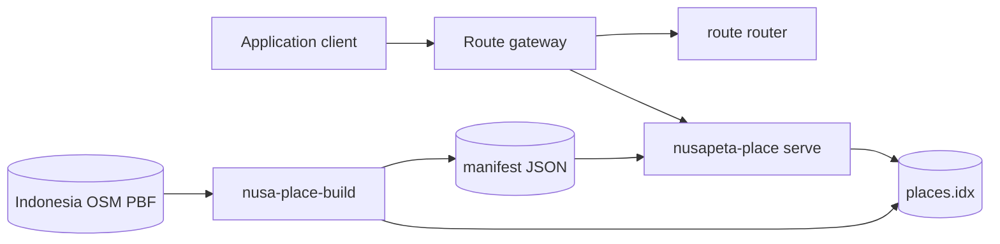
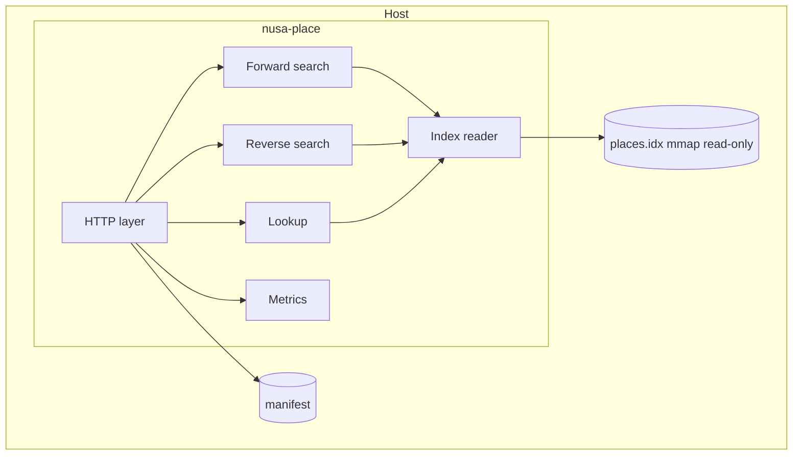
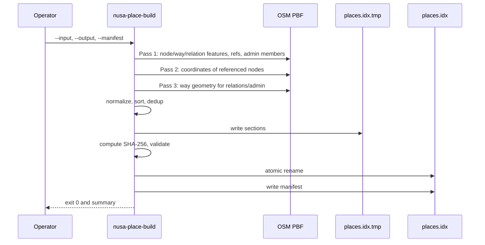
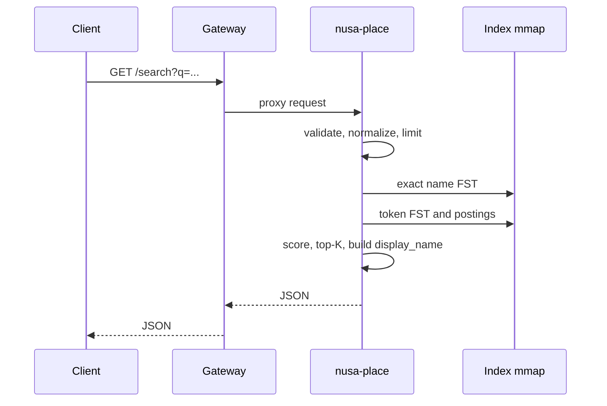
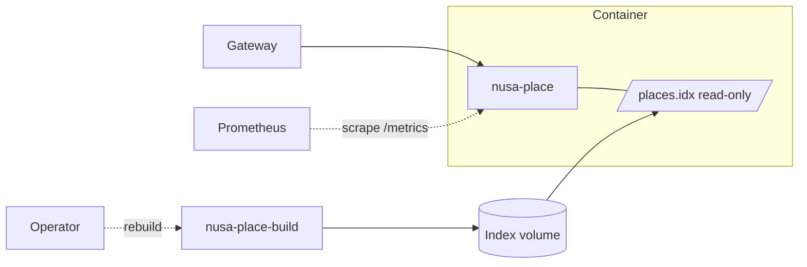

# Nusapeta Place Architecture

This document shows the system shape and component boundaries. Requirements are
in [SRS](../SRS.md); technical decisions and ranking are in [TRD](../TRD.md).
The Indonesian original is [`../ARCHITECTURE.md`](../ARCHITECTURE.md).

## 1. Context

`nusapeta-place` is an internal service behind the route gateway. Clients do not
need to know whether a search is served by the router or the geocoder.

Responsibility boundaries:

| Component | Responsibility |
|---|---|
| Gateway | TLS, auth, rate limit, routing |
| `nusa-place` | Request validation, search, response construction |
| `places.idx` | Feature data, names, postings, grid, admin |
| `nusa-place-build` | PBF selection, geometry, normalization, index writing |
| Manifest | Provenance, versions, checksums, feature counts |

## 2. Containers

No component writes the index while serving. v1 has no global query cache. Each
request reads records from the mmap and builds results on the stack or in a
request buffer.

## 3. Build flow

If any pass fails, the `.tmp` file is removed and the old index is unchanged.
The manifest is written after the index completes so no manifest points at a
half-written index.

## 4. Query flow

Reverse uses the same path but enters through the grid and computes distance.
Lookup enters through a binary search on `place_id` or parses `osm_ids`.

## 5. Deployment

One container serves one index. For higher availability, run two replicas with
the same index behind the gateway. v1 has no coordination between replicas; an
index is promoted by replacing the volume or by rolling restarts.

## 6. Invariants

1. The server only reads the index. There is no write path to the index at
   runtime.
2. The index is immutable for one process lifetime. A new index means a new
   process or a restart.
3. `place_id` is derived from `(osm_type, osm_id)`, not a build sequence number.
4. Builds are deterministic for the same PBF and builder version.
5. No database, PBF, or outbound network in the serving path.
6. `display_name` is assembled from the feature name and admin chain, not stored
   per feature as a long string.
7. Admin polygons are optional. Without a polygon, `address` is empty rather
   than invented.
8. Every index offset is validated before use.

## 7. Repository boundary

| Inside the repo | Outside the repo |
|---|---|
| Builder and server code | Route gateway |
| Index format and manifest | Raw PBF |
| API documentation | Built index data |
| Small PBF fixture | Production deployment |
| Test and benchmark harness | Monitoring dashboard |

The repo does not store `*.pbf`, `places.idx`, or `target/`. Index artifacts are
promoted through a volume or object storage, not through git.
